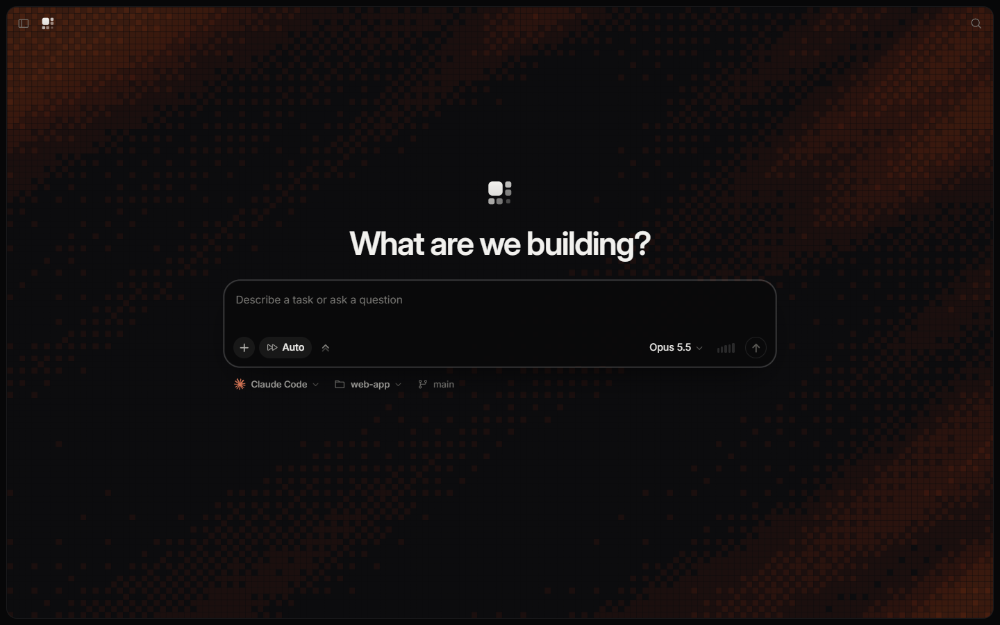
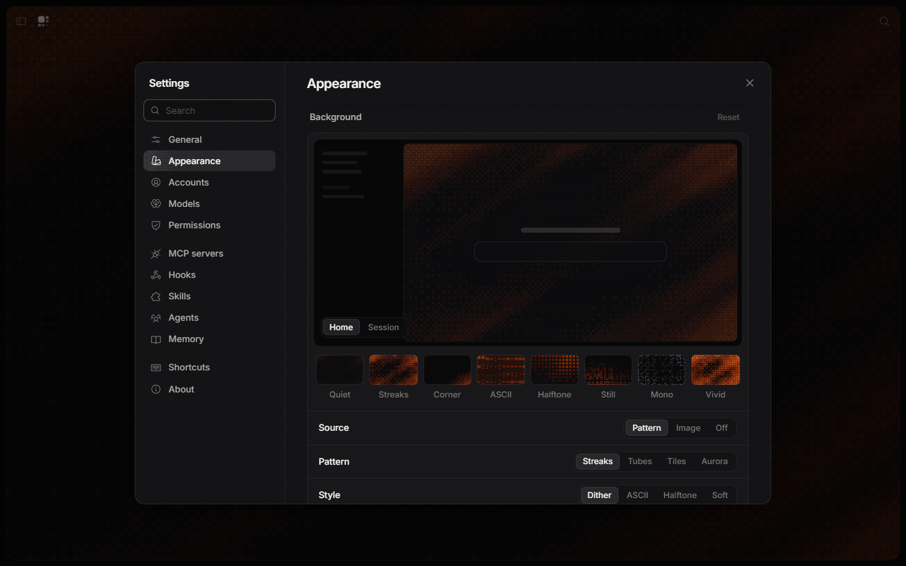

# Sable

Sable is a desktop app for working with coding agents. It runs the Claude Code and Codex CLIs you already have installed and signed in, and gives both one interface: a conversation timeline that shows every step the agent takes, a composer, cards for approvals and questions, and a side panel with your changes, files, a browser, a terminal and the agent's task list. Sable does not have its own model or account; your agents do the work, Sable shows it.





## Features

- Claude Code (through the Claude Agent SDK) and Codex (through `codex app-server`) in one timeline: messages, thinking, commands, file edits with diffs, searches, sub-agents, MCP tools, plans and todos.
- Permission cards with diff previews (allow once, always allow, deny with feedback) and keyboard-driven question cards.
- Queue a message while the agent works, or steer it into the running turn.
- Slash commands and skills (`/`), file mentions (`@`), shell commands (`!`), attachments and images.
- Side panel: git changes, file tree, a browser next to the conversation, a terminal, tasks and context usage.
- Several accounts per agent, permission modes, effort levels and model choice per session.
- History: browse and resume the conversations your agents keep on disk.
- Rewind to an earlier message, optionally restoring files.
- Command palette, keyboard shortcuts for everything, and an adjustable backdrop.

## Install

Download `Sable-Setup-<version>.exe` from the [Releases page](https://github.com/Leonxlnx/sable/releases) and run it. It installs for your user only, with no admin prompt, and opens Sable when it finishes.

Sable is Windows only for now. The installer is not code-signed, so Windows SmartScreen warns on first run: choose "More info", then "Run anyway".

Sable keeps its data in `~/.sable`. The uninstaller leaves that folder alone.

## Requirements

- Windows 10 or 11.
- Claude Code and/or the Codex CLI, installed and signed in. Sable uses their own sign-in; it never sees your password or tokens.

## Development

You need Node 22 or newer and pnpm.

```sh
pnpm install
pnpm dev                  # http://localhost:5173, with the bridge attached
pnpm test                 # vitest
pnpm typecheck
pnpm desktop:dist         # Windows installer in release/
```

`pnpm desktop:pack` builds `release/win-unpacked/Sable.exe` without an installer. `pnpm desktop:dist:sable` packages into `release-sable/` instead, for when a copy running from `release/` keeps its files locked.

In a dev build the scripted Demo agent is available, so you can work on the interface without spending quota: run `sable.demo('refactor the session module')` in the browser console.

Architecture, conventions and design rules are in [CLAUDE.md](CLAUDE.md).

## Trademarks

Sable is an independent project and is not affiliated with or endorsed by Anthropic or OpenAI. Claude and Claude Code are trademarks of Anthropic; OpenAI and Codex are trademarks of OpenAI. The Claude and Codex marks shown next to each agent come from [`@lobehub/icons-static-svg`](https://github.com/lobehub/lobe-icons) (MIT) and are used only to identify those products.

## License

[MIT](LICENSE)
